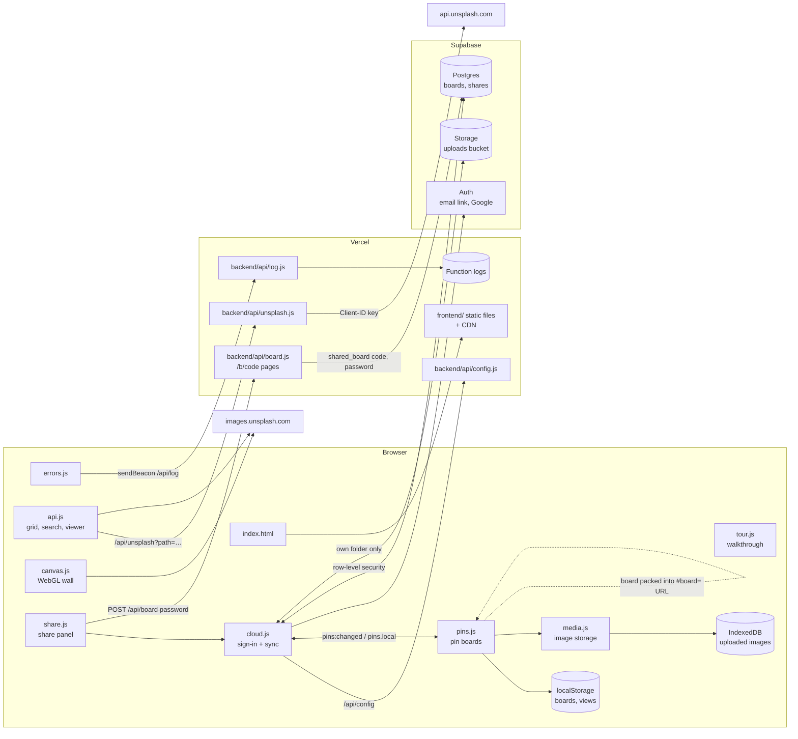

# Aperture architecture

Aperture is split into a **frontend** (`frontend/`, a static site with no build step or framework) and a
**backend** (`backend/`: four small serverless functions plus a Supabase database for accounts),
hosted on Vercel. Boards are offline-first: the browser copy is the one being edited, and when someone
signs in it is mirrored to Supabase so their devices stay in step. Without an account, or when
Supabase isn't configured, everything stays on the device.



## Repository layout

```
frontend/            the site, served as-is (Vercel's output directory)
  index.html         all markup: grid page, canvas, board, lightbox, menus
  css/
    style.css        all app styles (design tokens on :root)
    legal.css        styles for the legal pages
  js/
    errors.js        uncaught-error reporting (loaded first, in <head>)
    api.js           globals + grid page: search, filters, infinite scroll, lightbox, custom cursor
    canvas.js        infinite WebGL2 wall of the current results (window.canvasView)
    media.js         IndexedDB image store, downscaling, palette extraction (window.media)
    pins.js          pin boards (window.pins), the largest file
    tour.js          first-run board walkthrough (window.tour)
    cloud.js         accounts and cloud sync (window.cloud)
    share.js         Share panel: short links, passwords, new link, stop sharing; visitors' password prompt
  img/               og.jpg (link preview), favicon.svg
  pages/             privacy.html, terms.html (served at /privacy and /terms)
backend/
  api/
    unsplash.js      GET proxy: holds the key, allow-lists endpoints and params, sets CDN cache headers
    log.js           POST endpoint: allow-lists and trims error reports, writes them to the logs
    config.js        GET: the public Supabase URL and anon key, or {} when accounts aren't set up
    board.js         GET /b/<code>: index.html with the board's link-preview tags and the board embedded;
                     POST: a password-protected board, given the right password
  supabase/
    schema.sql       boards and shares tables, uploads bucket, row-level security, shared_board()
                     (run in Supabase; re-run after it changes)
api/                 Vercel entry points only: Vercel looks for functions in /api, so each file
                     re-exports the real one from backend/api/ in one line
dev.mjs              local server: serves frontend/, runs the backend functions, applies vercel.json's
                     rewrites/redirects, caches proxy responses in memory
tests/               node:test unit tests + Playwright browser tests (Unsplash mocked)
vercel.json          output dir, clean URLs, rewrites (/privacy, /terms, /b/:code), redirects for old
                     asset URLs, cache + security headers
index.html (root)    redirect from the old GitHub Pages URL
```

## Frontend

Classic `<script>` files, each wrapped in an IIFE, loaded in this order:
GSAP + ScrollTrigger + Flip + Lenis (CDN) → `js/api.js` → `js/media.js` → `js/pins.js` → `js/tour.js` →
`js/cloud.js` → `js/share.js` → `js/canvas.js` (`js/errors.js` loads first, in `<head>`).

- **`api.js`** defines the shared globals the others rely on: `state` (current mode, query, filters,
  `photos`, paging token), `q`/`qa`, `api(path, params)`, `openLightbox`, `lb`, `lightbox`, `gsap`,
  `reduceMotion`, the custom cursor. Modes: `feed`, `search`, `user` (one photographer).
- **`canvas.js`** draws the wall in one full-screen shader. Photos go into a texture atlas, and the
  shader works out each pixel's tile, so the wall is infinite in one draw call. Resolution adapts when
  frames run slow. It pauses and is CSS-blurred once while the board is open.
- **`pins.js`** is the board. It sits inside the canvas view (open the canvas before the board).
  Sections, in file order: toasts and storage → sanitising (`cleanItem`, `cleanBoard`) and
  migration → undo → items → layout and render (`geo` cache of card positions, threads, pin heads)
  → menus and selection → pointer gestures → keyboard → adding things (uploads, links, notes, tray)
  → find, minimap, palette → open/close, export, share, storage sync → `window.pins`.
- **`tour.js`** listens for the `pins:open` / `pins:close` events that `pins.js` dispatches.
- **`cloud.js`** listens for `pins:changed` / `pins:deleted` and applies remote boards through
  `window.pins.local` (see *Accounts and sync*). It loads the Supabase library from the CDN only when
  `/api/config` says accounts are set up.

Modules talk through these globals and a few window APIs: `window.pins`, `window.canvasView`,
`window.media`, `window.toast`, `window.reportProblem`, `window.tour`, `window.cloud`.

## Board data

```
localStorage
  aperture:boards              { active, list: [{ id, name, updated }] }   updated = last local edit (ms), 0 = untouched
  aperture:board:<id>          { name, pins: [item], threads: [{ a, b, label }], frames: [{ id, x, y, w, h, title }] }
  aperture:board-view:<id>     camera { x, y, z }
  aperture:minimap             minimap on/off
  aperture:tour                "done" once the walkthrough has been seen
  aperture:auth                Supabase session (when signed in)
  aperture:cloud-owner         id of the account whose boards this device holds
  aperture:cloud-tombstones    boards deleted here, not yet sent
  aperture:cloud-blobs         upload ids already in cloud storage
IndexedDB  aperture-media / blobs   uploaded image blobs, keyed by item id
```

An item has a `kind`:

| kind | id prefix | holds |
|---|---|---|
| `unsplash` | photo id | a trimmed photo record (urls.raw, user, colour, size) |
| `upload` | `u-` | `media` metadata; the image blob is in IndexedDB |
| `link` | `l-` | `media.href`, plus `media.src` if it's an image |
| `note` | `n-` | text and a tint |

Each item also has a position (`bx`, `by`), a rotation `r` and a note. Everything read from storage,
imports or share links goes through `cleanItem` / `cleanBoard`, which allow-list fields and check URLs.

**Camera.** `view` eases toward a `goal` (zoom in log space) around an anchor point, so zoom stays
under the cursor. Pointer work is batched to one job per animation frame (`onFrame`), and gestures
read card positions from the `geo` cache, never from layout.

**Threads** are SVG paths in one layer above all cards. Pins that hold a thread get their head redrawn
above that layer so strings end under the pin.

## Sharing and export

- **Short share link (signed in, #18–19):** Share opens the share panel (`share.js`). *Create link*
  syncs the board, then makes (once per board) a row in the `shares` table with a random 10-character
  code, giving `/b/<code>`. The link points at the board, not a snapshot, so it shows the latest synced
  copy. The panel also sets who can open it (anyone with the link, or only with a password), makes a
  *New link* (a new code; the old address stops working, the password stays) and *Stop sharing*
  (deletes the row). Passwords are hashed in the database (`set_share_password`, bcrypt) and the
  browser never sees the hash. `backend/api/board.js` answers `/b/<code>`:
  it looks the board up through the public `shared_board(code)` function, which strips uploads, then
  serves `index.html` with the board's name, a description ("3 photos and 1 note…") and the first
  Unsplash photo (cropped 1200×630) in the title and `og:` tags, so chat apps show a real preview. It
  adds `<base href="/">` (the page lives under `/b/`) and embeds the board as JSON in
  `#shared-board`, which `pins.js` passes through `cleanBoard` and opens read-only. Cached at the
  edge for 15 s, so edits, a new password or *Stop sharing* reach the link quickly; unknown codes get a
  404 page that says the board is gone. Deleting the board (or the account's data) removes its share.
- **Password-protected link (#19):** the `/b/<code>` page embeds only `{ code, locked: true }` and a
  generic preview (no name, counts or cover). Once the wall is up, `share.js` asks for the password
  and POSTs `{ code, password }` to `/api/board` (never in a URL); the board comes back as JSON and
  opens like any other. `shared_board()` counts wrong tries per link: after 10 in 15 minutes it stops
  checking until the window ends (the visitor sees "too many wrong tries").
- **Hash share link (signed out, or the account can't be reached):** the board is packed (format v2;
  v1 still opens), deflate-raw compressed and base64url-encoded into `#board=…`. Nothing is uploaded.
- Both: uploads are left out, and recipients get a read-only copy they can save.
- **Board file (JSON, v4):** includes uploads as data URLs; importing merges and restores the blobs.
- **PNG:** drawn on a 2D canvas, then each Unsplash photo is reported to `/photos/<id>/download`,
  as the API guidelines ask.

## Accounts and sync

Supabase holds these, all locked to their owner by row-level security
(`backend/supabase/schema.sql`):

- **Auth:** email magic link and Google. The session lives in localStorage (`aperture:auth`), not a cookie.
- **`boards` table:** one row per board per person: `owner`, `id`, `name`, `data` (the whole board as
  JSON), `updated` (the browser's last-edit time), `deleted` (tombstone).
- **`uploads` bucket:** private; each person's images live under `<user id>/<item id>`.
- **`shares` table:** `code`, `owner`, `board_id` (one per board), plus `pass_hash`, `fails`,
  `fail_window` and a generated `protected` flag. Owners get column-level access only (read
  `code, protected`; change `code`), so the hash and try counts stay server-side. Nobody can list
  shares; the only public read is `shared_board(code, password)`, a security-definer function that
  returns one live board minus uploads, or a status (`locked`, `wrong`, `slow`).

`cloud.js` syncs on sign-in, 1.5 s after a local change, when the tab becomes visible or comes back
online, and every 45 s while visible. Each sync:

1. Sends tombstones for boards deleted on this device.
2. Lists the account's boards (`id, updated, deleted`) and compares them with this device's.
3. Pulls boards whose remote copy is newer, then downloads any uploaded images they need.
4. Drops boards deleted elsewhere (unless they were edited here after the delete).
5. Pushes boards that are newer here, uploading their images first.

The newer copy of a whole board wins. Two devices editing the same board between syncs keep the later
edit. On first sign-in every board on the device is pushed (the untouched starter board is skipped).
**Sign out** removes the device's copy; a session that simply expires keeps it. If a *different*
account signs in on a device holding another account's boards, the device is cleared first so
boards never leak between accounts. *Delete my cloud data* removes every row and file in the account.

## Server side

All backend code is in `backend/api/`. The files in the root `api/` folder only re-export them.

- **`unsplash.js`**: only `/photos`, `/search/photos`, `/photos/<id>/download` and
  `/users/<username>/photos` are forwarded, each with an allow-list of params (values cut to 200
  chars). Successful responses: 5 min in the browser, 1 h at the edge, stale for a day. Download
  tracking and errors aren't cached. Rate-limit headers aren't forwarded.
- **`log.js`**: rejects bodies over 6,000 chars or bad JSON. Keeps only kind, message, stack,
  path, view and build, trimmed, and logs them with the prefix `[client-error]`. No IP, user agent
  or query strings.
- **`board.js`**: `/b/<code>` (rewritten to `/api/board?code=`). Codes must be 10–16 letters or
  digits or the database isn't asked. `POST /api/board` takes `{ code, password }` (body up to 2,000
  chars, password up to 200) and answers 200 with the board, 403 wrong, 429 too many tries, 404 gone;
  never cached. Reads `frontend/index.html` from disk (`includeFiles` in
  vercel.json), falling back to fetching `/`. Everything put into the HTML is escaped, and `<` in the
  embedded JSON is written as `\u003c`. A failed lookup is a 502 page that isn't cached. `noindex`.
- **`config.js`**: returns `{ supabase: { url, anonKey } }` only when both env vars are set and the URL
  is a Supabase project URL; otherwise `{}`, which keeps accounts switched off. The anon key is public by
  design; the service-role key is never used by the app.
- **Env** (Vercel env vars; `.env.local` for `dev.mjs`, gitignored): `UNSPLASH_ACCESS_KEY`, `SUPABASE_URL`,
  `SUPABASE_ANON_KEY`.

## Testing and CI

- `npm run test:unit`: `node --test` on the backend functions (fetch and console stubbed).
- `npm run test:e2e`: Playwright (Chromium 1.55.0). `tests/mock.js` answers `/api/unsplash` and
  serves generated PNGs for `images.unsplash.com`, so no key is needed and the rate limit is never
  touched. `tests/fixtures.js` records `sendBeacon` calls, fails a test on any uncaught page error,
  and marks the walkthrough as seen (`tour.spec.js` turns it back on).
- `tests/cloud.spec.js` also covers share links and passwords: `/b/` pages and `POST /api/board`
  come from the real `board.js` (its `respond` / `unlock(request, find)` exports) reading the fake's
  boards, which mimics `shared_board()`'s statuses.
- `tests/cloud.spec.js`: accounts and sync against an in-memory Supabase stand-in in the test process
  (`window.__apertureBackend`), with ownership enforced like row-level security. Two browser profiles
  act as two devices. Other tests get `{}` from `/api/config`, so they stay local-only.
- `tests/supabase-lock.spec.js`: the real Supabase wrapper in `cloud.js` against a stand-in library that,
  like supabase-js, runs auth callbacks inside its lock. Guards against the start-up deadlock (sync stuck
  on "Syncing…"): `cloud.js` reacts to auth changes only after the callback returns.
- `tests/a11y.spec.js`: axe-core, fails on serious or critical issues.
- CI (`.github/workflows/test.yml`) has no GPU, so `CI` or `SOFTWARE_GL=1` switches Chromium to
  software WebGL and the fixtures switch off CSS blurs (decoration only), which would otherwise make the
  board crawl. Two workers, one retry.

## Deploy

Pushing to `main` deploys to Vercel (https://aperture-bice-nine.vercel.app) and runs the tests on GitHub.

## Limits

- Unsplash demo key: 50 requests/hour across all visitors (CDN caching softens it).
- The browser copy is still the working copy, so localStorage's ~5 MB limit applies per device; the
  app warns near it. A board row is capped at ~2 MB, and an uploaded image at 15 MB.
- Sync works per whole board: simultaneous edits to the same board on two devices keep the later one.
  Live collaboration (Phase 3) would need per-item changes over Supabase Realtime.
- Deleting the account itself (not just its data) needs the service-role key on the server; for now
  it is done on request.
